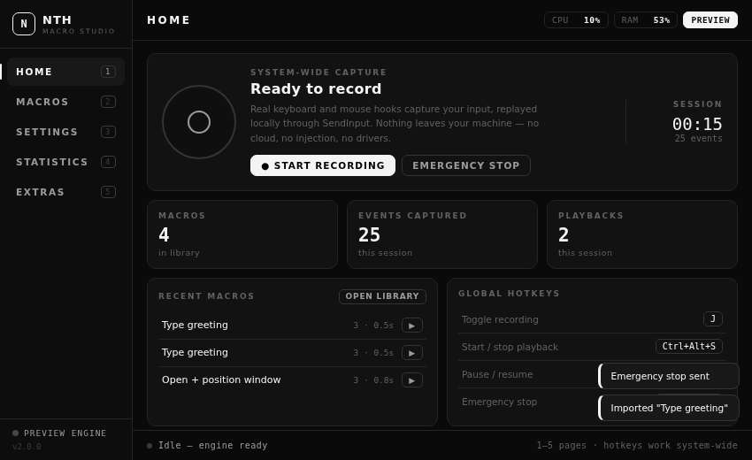
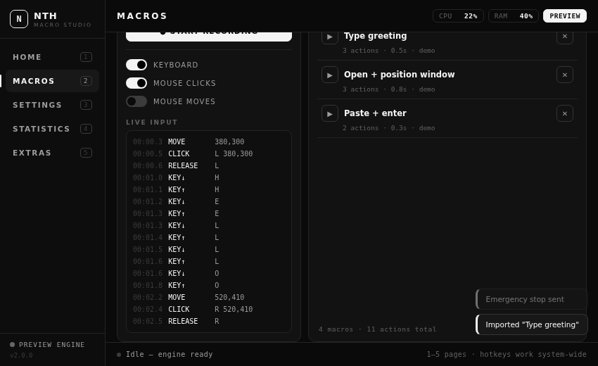
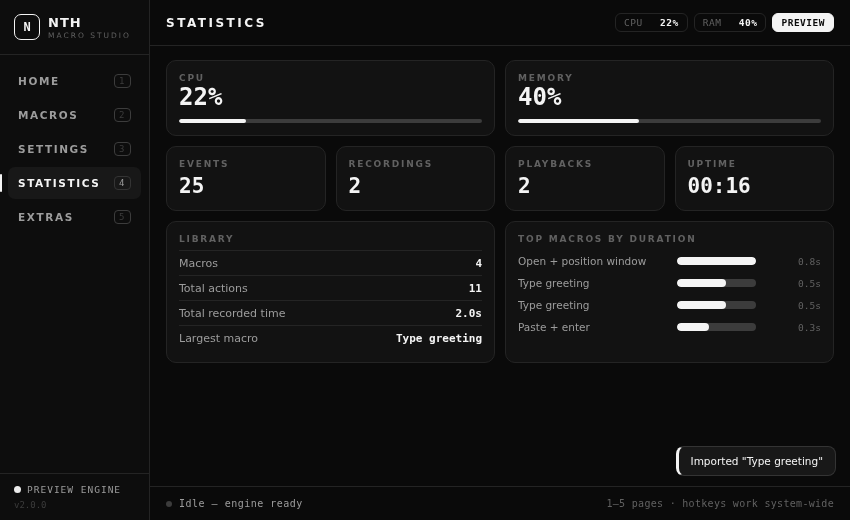
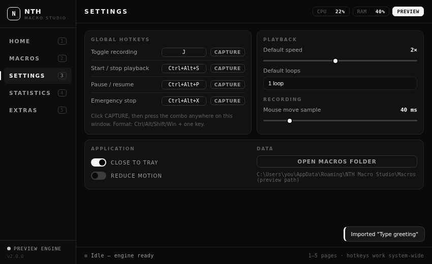
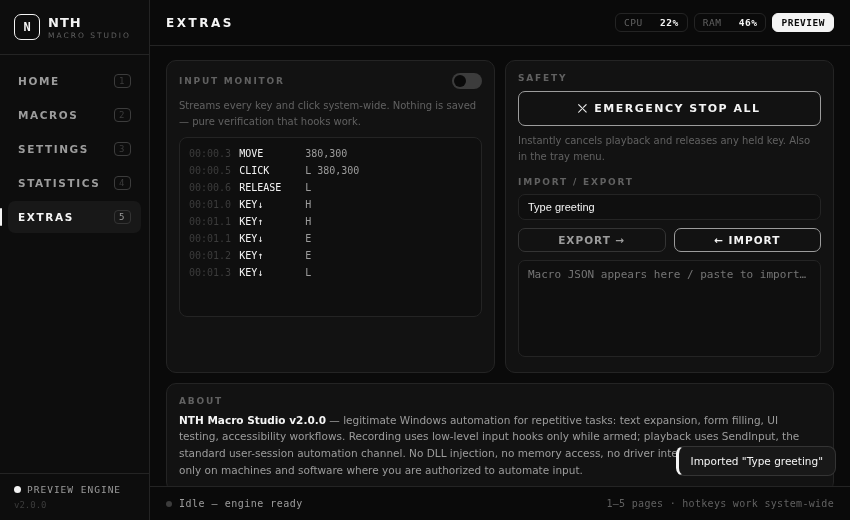

# NTH Macro Studio

<p align="center">
  <a href="https://github.com/flexyfresh8-prog/nth-macro-studio/actions/workflows/build.yml"></a>
  
  
  
  
</p>

<p align="center">
  
</p>

**NTH Macro Studio** is a real, working macro tool for Windows — a compact 850×520 monochrome desktop app (C#/.NET 8 + WebView2) that **actually records your keyboard and mouse and replays it**. No placeholder screens, no fake data in the app: every button talks to a native recording/playback engine.

---

## What it really does

| Area | What you get |
| --- | --- |
| **Record** | System-wide keyboard + mouse capture via low-level Windows hooks, armed only while you are recording. Live input feed, live timer, capture toggles (keys / clicks / moves), auto-trim of long silences, auto-save on stop |
| **Replay** | True `SendInput` playback on a background thread — speed 0.25×–4×, 1/3/10/infinite loops, live per-action progress, pause/resume, instant emergency stop |
| **Manage** | Macros persist as plain JSON you own in `%AppData%\NTH Macro Studio\Macros` — rename, delete, search, import/export raw JSON |
| **Hotkeys** | System-wide `RegisterHotKey` slots — toggle recording, start/stop, pause/resume, emergency stop — all re-bindable in Settings |
| **Monitor** | Extras → Input Monitor streams every key/click system-wide without saving anything — instant proof the hooks work |
| **Tray** | Close to tray keeps hotkeys alive; tray menu has Open / Emergency Stop / Exit |

## Screenshots

| Recorder + Library | Statistics |
| --- | --- |
|  |  |

| Settings | Extras |
| --- | --- |
|  |  |

## Browser preview (no install)

Open **`preview/index.html`** in any browser. It is the identical UI running against a built-in mock engine (clearly badged **PREVIEW** in the top bar) so you can try the flow — but only the Windows app captures system-wide input and replays it for real.

## Architecture

```
┌────────────────────────────────────────────────────────┐
│  NTH Macro Studio.exe — WinForms host, 850×520 fixed   │
│                                                        │
│  ┌──────────────────────────────────────────────────┐  │
│  │  WebView2 — wwwroot/index.html (monochrome UI)   │  │
│  │  same file as preview/index.html                 │  │
│  └──────────────┬───────────────────────────────────┘  │
│                 │ JSON messages  {type, payload}       │
│  ┌──────────────┴───────────────────────────────────┐  │
│  │  Bridge (C#)                                     │  │
│  │   ├─ HookRecorder   WH_KEYBOARD_LL / WH_MOUSE_LL │  │
│  │   ├─ MacroPlayer    SendInput replay, loops      │  │
│  │   ├─ GlobalHotkeyManager  RegisterHotKey slots   │  │
│  │   ├─ MacroStore     %AppData% JSON macros        │  │
│  │   └─ SystemMonitor  CPU / RAM sampling           │  │
│  └──────────────────────────────────────────────────┘  │
└────────────────────────────────────────────────────────┘
```

- **Recorder**: `SetWindowsHookEx` low-level hooks are armed **only while you are recording** and removed the instant you stop.
- **Player**: replays your recorded actions through `SendInput` — the standard Windows automation channel. No code injection into other processes, no memory reading, no driver interposition, no network.
- **Safety**: emergency stop (`Ctrl+Alt+X`, Home, Extras, tray menu) cancels playback between input slices and releases any held key.

Full protocol documentation: [`docs/BRIDGE.md`](docs/BRIDGE.md).

## Quick start (Windows)

1. Download the **[v2.00 release](https://github.com/flexyfresh8-prog/nth-macro-studio/releases/tag/v2.00)** zip (or build it yourself below) and extract.
   - `NTH-Macro-Studio-v2.00-win-x64.zip` — framework-dependent, ~0.7 MB (needs the [.NET 8 Desktop Runtime](https://dotnet.microsoft.com/download/dotnet/8.0))
   - `NTH-Macro-Studio-v2.00-win-x64-selfcontained.zip` — standalone ~60 MB, no runtime install needed
2. Run **`NTH Macro Studio.exe`**.
   - WebView2 Runtime is preinstalled on up-to-date Windows 10/11; if missing, the app shows a download link on first launch.
3. Press **● START RECORDING** (or `Ctrl+Alt+R` anywhere in Windows), do some typing/clicking, press **■ STOP & SAVE** — the macro is saved automatically. Open **MACROS** (key `2`) and press ▶.
4. Playback clicks at recorded screen coordinates — put the target window in the same place first, or record with **MOUSE MOVES** enabled for absolute positioning.

## Build from source

```powershell
git clone https://github.com/flexyfresh8-prog/nth-macro-studio.git
cd nth-macro-studio
.\build.ps1                 # → dist\NTH Macro Studio.exe
.\build.ps1 -SelfContained  # → standalone build
```

Works on Windows, and cross-compiles from Linux/macOS too (`EnableWindowsTargeting=true`). Details: [`docs/BUILDING.md`](docs/BUILDING.md). CI builds both variants on every push (`.github/workflows/build.yml`); tagging `v2.0.0`-style tags publishes a GitHub Release automatically ([`docs/RELEASING.md`](docs/RELEASING.md)).

## Global hotkeys (defaults)

| Slot | Combo | Action |
| --- | --- | --- |
| Toggle recording | `Ctrl+Alt+R` | Start/stop recording from anywhere |
| Start/Stop playback | `Ctrl+Alt+S` | Fires or halts the selected macro |
| Pause/Resume | `Ctrl+Alt+P` | Holds playback at the current action |
| **Emergency stop** | `Ctrl+Alt+X` | Instantly cancels everything |

All four are re-bindable in **Settings** (click **CAPTURE**, press the combo) and persist to `%AppData%\NTH Macro Studio\settings.json`.

## Authorized use & privacy

- NTH Macro Studio automates **only the inputs you recorded, on your machine, under your control**.
- It does **not** inject code into other processes, read their memory, bypass anti-cheat systems, or interact with applications you have not chosen. Using recorded input replay to gain unfair advantages in online games may violate those games' terms — use responsibly and only where you are authorized.
- Macros, settings and recordings stay in `%AppData%\NTH Macro Studio`. No telemetry, no accounts, no network access.

## Project structure

```
nth-macro-studio/
├─ preview/index.html            ← standalone UI (open in Chrome, mock engine)
├─ src/NthMacroStudio/
│  ├─ Program.cs / AppWindow.cs  ← WinForms + WebView2 host, 850×520
│  ├─ Bridge.cs                  ← JS ⇄ C# message router
│  ├─ Settings.cs / TrayService.cs
│  ├─ Core/        Macro.cs, MacroStore.cs
│  ├─ Recording/   HookRecorder.cs
│  ├─ Playback/    MacroPlayer.cs
│  ├─ Input/       InputInjector.cs
│  ├─ Hotkeys/     GlobalHotkeyManager.cs
│  ├─ Monitoring/  SystemMonitor.cs
│  ├─ Interop/     NativeMethods.cs
│  └─ wwwroot/     (the monochrome UI bundled with the exe)
├─ docs/           BUILDING, RELEASING, AUTHENTICATION, BRIDGE, screenshots
├─ .github/workflows/build.yml
├─ build.ps1 / build.cmd / NthMacroStudio.sln
└─ LICENSE (MIT) / .gitignore
```

## Contributing & license

PRs are welcome — keep the safety model intact. MIT licensed; see [LICENSE](LICENSE).
