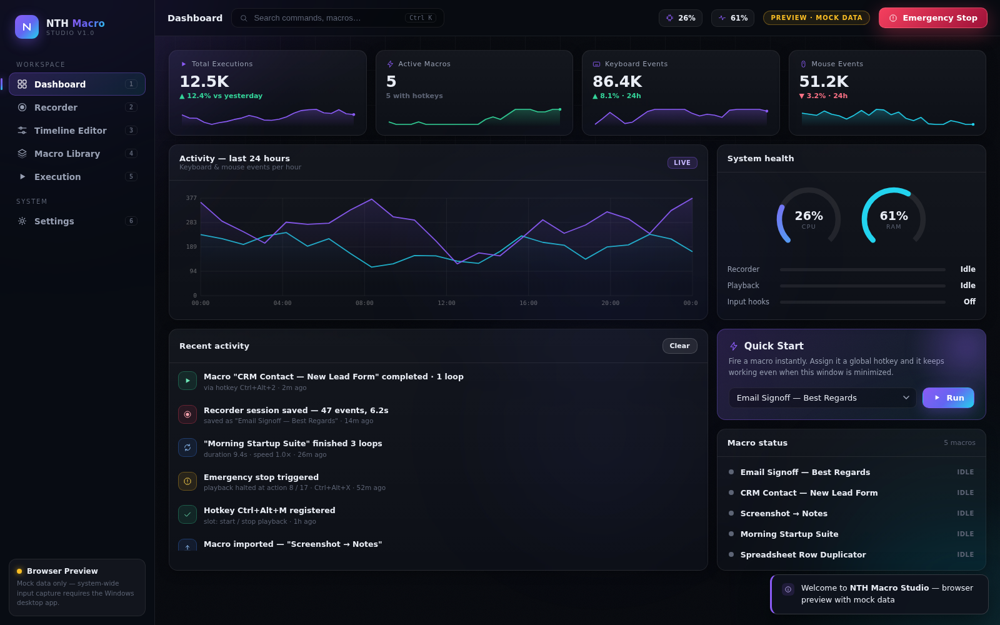
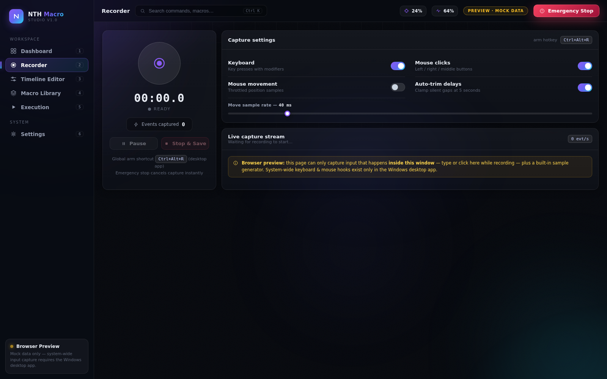
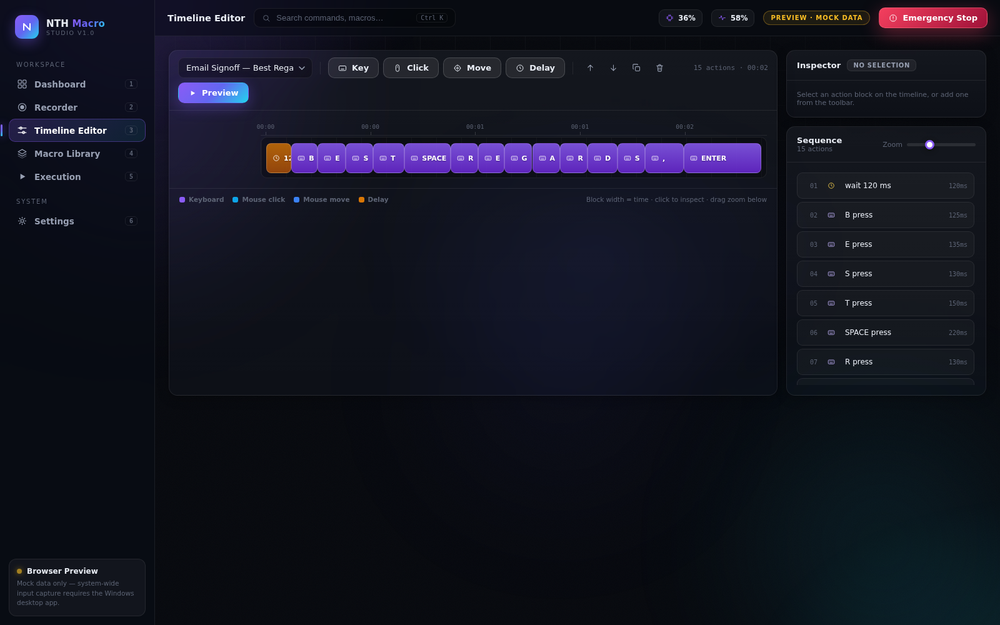
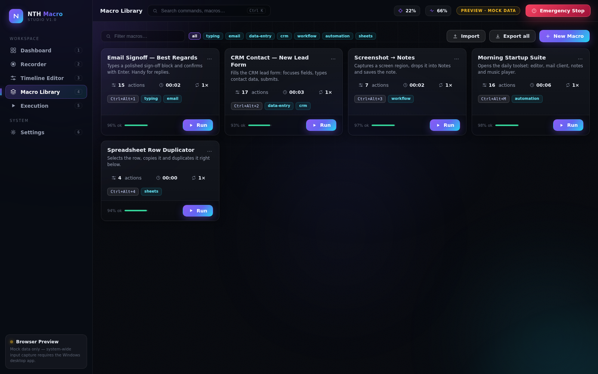
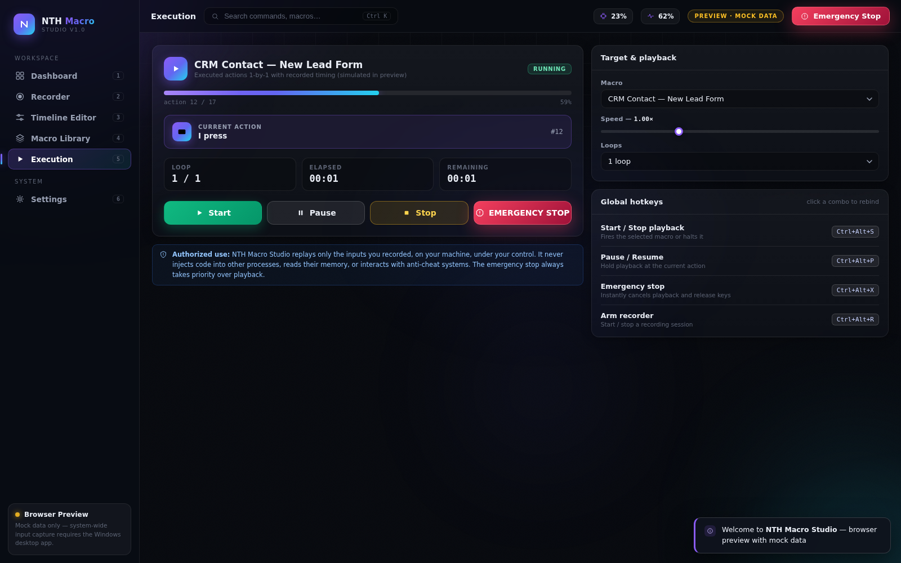

# NTH Macro Studio

<p align="center">
  <a href="https://github.com/flexyfresh8-prog/nth-macro-studio/actions/workflows/build.yml"></a>
  
  
  
</p>

<p align="center">
  
</p>

**NTH Macro Studio** is a premium Windows macro automation suite: a native C#/.NET 8 desktop app whose entire interface is a fast, glassy, dark WebView2 UI — the same pixel-perfect interface you can preview in any browser.

Record keyboard & mouse actions, edit them on a visual timeline, and replay them with speed control and loops — always under your control, with an emergency stop that always works.

---

## Highlights

| Area | What you get |
| --- | --- |
| **Dashboard** | Macro status, active macros, total executions, keyboard & mouse activity charts, recent activity feed, live CPU/RAM gauges, quick-start launcher |
| **Recorder** | System-wide keyboard capture, mouse clicks, throttled mouse movement, exact timing capture, pause/resume, stop & save, auto-trim of long silences |
| **Timeline Editor** | Visual timeline of every action, add key/click/move/delay, reorder, duplicate, delete, live inspector, zoom, animated preview playhead |
| **Macro Library** | Card grid with search, tag filters, per-macro hotkeys, duplicate/export/import/delete, JSON portability |
| **Execution** | Start/pause/stop, big emergency stop, live progress, current action, loop counter, elapsed/remaining, speed 0.25×–3×, configurable global hotkeys |
| **Design** | Dark glass interface, gradient accents, animated ambient background, custom SVG icon set, micro-interactions, command palette (`Ctrl+K`), responsive layout |

## Screenshots

| Recorder | Timeline Editor |
| --- | --- |
|  |  |

| Macro Library | Live Execution |
| --- | --- |
|  |  |

## Browser preview (no install)

Open **`preview/index.html`** directly in Chrome — no server, no build. It reproduces the desktop app's UI with mock data and honest labeling: the preview can only capture input **inside its own window** (plus a built-in sample generator) and clearly says so. System-wide capture exists only in the Windows app.

Handy preview URLs: `preview/index.html#dashboard` … `#recorder` / `#editor` / `#library` / `#execution` / `#settings`, and `preview/index.html?demo=1#execution` to auto-start a simulated run.

## Architecture

```
┌────────────────────────────────────────────────────────────┐
│  NTH Macro Studio.exe (WinForms host, dark title bar)      │
│                                                            │
│  ┌──────────────────────────────────────────────────────┐  │
│  │  WebView2 — wwwroot/index.html (the premium UI)      │  │
│  │  same file as preview/index.html                     │  │
│  └──────────────┬───────────────────────────────────────┘  │
│                 │ JSON messages  {type, payload}           │
│  ┌──────────────┴───────────────────────────────────────┐  │
│  │  Bridge (C#)                                         │  │
│  │   ├─ HookRecorder   low-level keyboard/mouse hooks   │  │
│  │   ├─ MacroPlayer    SendInput replay, loops, speed   │  │
│  │   ├─ GlobalHotkeyManager  RegisterHotKey slots       │  │
│  │   ├─ MacroStore     %AppData% JSON macros            │  │
│  │   └─ SystemMonitor  CPU / RAM sampling               │  │
│  └──────────────────────────────────────────────────────┘  │
└────────────────────────────────────────────────────────────┘
```

- **Recorder**: `SetWindowsHookEx` low-level hooks are armed **only while you are recording** and are removed the instant you stop.
- **Player**: replays your recorded actions through `SendInput` — the standard Windows automation channel. No code injection into other processes, no memory reading, no anti-cheat interaction.
- **Safety**: emergency stop (`Ctrl+Alt+X`, the top-bar button, the execution panel, the tray menu) cancels playback between input slices and releases any held key.

Full protocol documentation: [`docs/BRIDGE.md`](docs/BRIDGE.md).

## Quick start (Windows)

1. Download the release zip (or build it yourself below) and extract.
2. Run **`NTH Macro Studio.exe`**.
   - Framework-dependent build: needs the [.NET 8 Desktop Runtime](https://dotnet.microsoft.com/download/dotnet/8.0) and the [WebView2 Runtime](https://developer.microsoft.com/microsoft-edge/webview2/) (preinstalled on Windows 11).
   - Self-contained build: needs only the WebView2 Runtime.
3. Click **Recorder → Record**, do some typing/clicking, **Stop & Save**, edit on the timeline, assign a hotkey, press **Start** on the Execution panel.

## Build from source

```powershell
git clone https://github.com/flexyfresh8-prog/nth-macro-studio.git
cd nth-macro-studio
.\build.ps1                 # → dist\NTH Macro Studio.exe
.\build.ps1 -SelfContained  # → standalone build
```

Works on Windows, and cross-compiles from Linux/macOS too (`EnableWindowsTargeting=true`). Details: [`docs/BUILDING.md`](docs/BUILDING.md). CI builds both variants on every push (`.github/workflows/build.yml`); tagging `v1.2.3` publishes a GitHub Release automatically ([`docs/RELEASING.md`](docs/RELEASING.md)).

## Global hotkeys (defaults)

| Slot | Combo | Action |
| --- | --- | --- |
| Start/Stop playback | `Ctrl+Alt+S` | Fires or halts the selected macro |
| Pause/Resume | `Ctrl+Alt+P` | Holds playback at the current action |
| **Emergency stop** | `Ctrl+Alt+X` | Instantly cancels everything |
| Arm recorder | `Ctrl+Alt+R` | Starts/stops a recording session |

All four are re-bindable in the Execution panel (click a combo) and persist to `%AppData%\NTH Macro Studio\settings.json`.

## Authorized use & privacy

- NTH Macro Studio automates **only the inputs you recorded, on your machine, under your control**.
- It does **not** inject code into other processes, read their memory, bypass anti-cheat systems, or interact with applications you have not chosen. Using recorded input replay to gain unfair advantages in online games may violate those games' terms — use responsibly and only where you are authorized.
- Macros, settings and recordings stay in `%AppData%\NTH Macro Studio`. No telemetry, no accounts, no network access.

## Project structure

```
nth-macro-studio/
├─ preview/index.html            ← standalone UI (open in Chrome)
├─ src/NthMacroStudio/
│  ├─ Program.cs / AppWindow.cs  ← WinForms + WebView2 host
│  ├─ Bridge.cs                  ← JS ⇄ C# message router
│  ├─ Settings.cs / TrayService.cs
│  ├─ Core/        Macro.cs, MacroStore.cs
│  ├─ Recording/   HookRecorder.cs
│  ├─ Playback/    MacroPlayer.cs
│  ├─ Input/       InputInjector.cs
│  ├─ Hotkeys/     GlobalHotkeyManager.cs
│  ├─ Monitoring/  SystemMonitor.cs
│  ├─ Interop/     NativeMethods.cs
│  └─ wwwroot/     (the UI bundled with the exe)
├─ docs/           BUILDING, RELEASING, AUTHENTICATION, BRIDGE, screenshots
├─ .github/workflows/build.yml
├─ build.ps1 / build.cmd / NthMacroStudio.sln
└─ LICENSE (MIT) / .gitignore
```

## Contributing & license

PRs are welcome — keep the safety model intact. MIT licensed; see [LICENSE](LICENSE).
